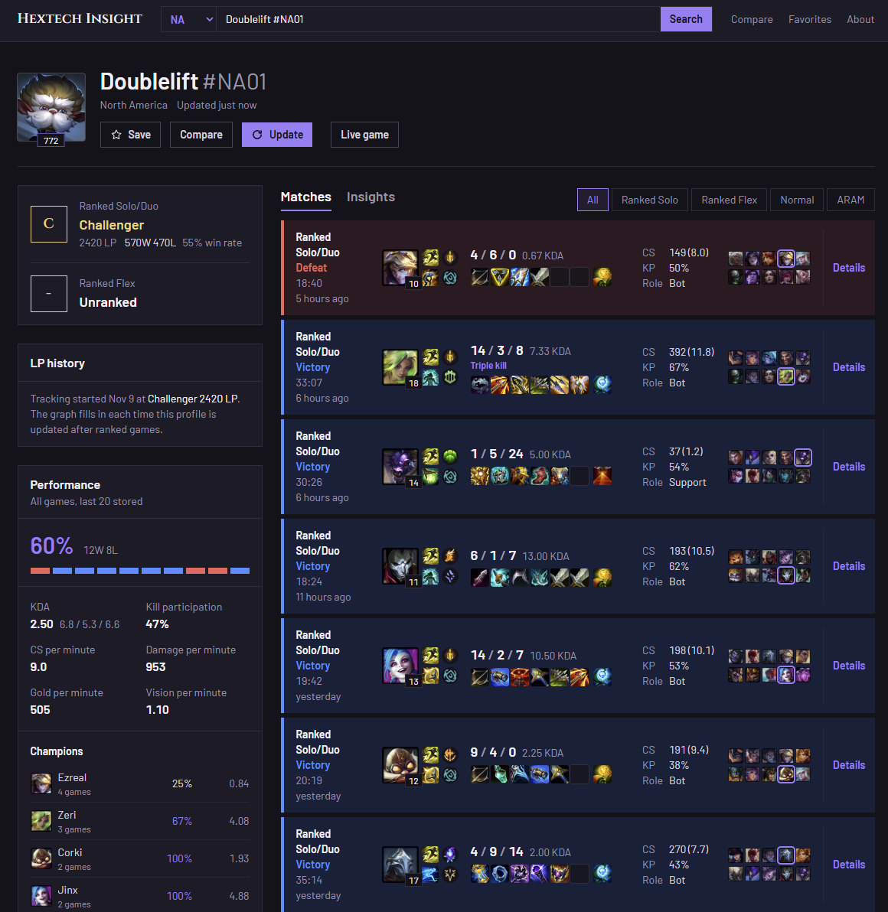
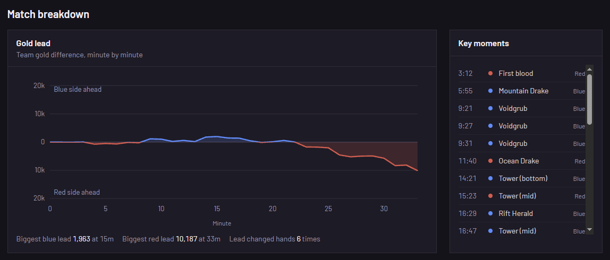
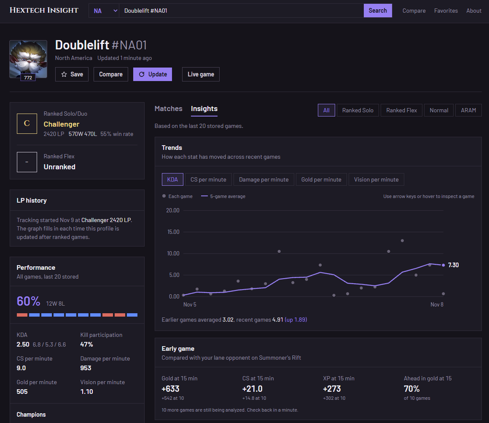
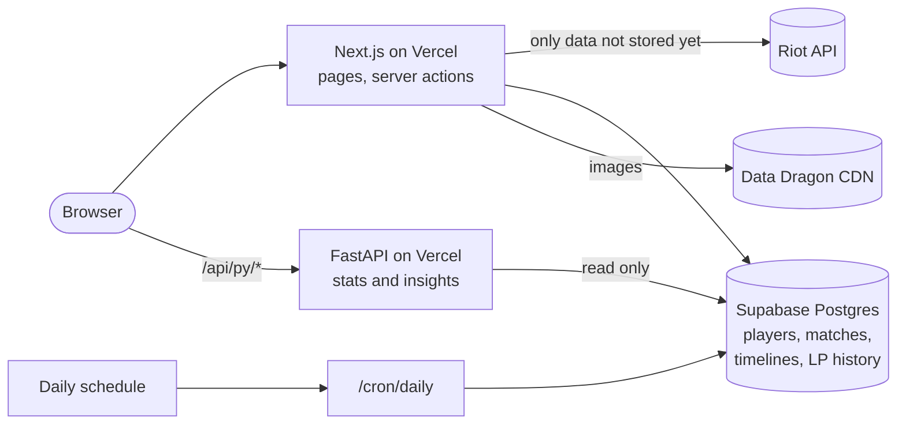

# Hextech Insight

[](https://github.com/2SikNinja/Hextech-Insight/actions/workflows/ci.yml)

Live at **[hextech.ppeternnguyen.com](https://hextech.ppeternnguyen.com)**

League of Legends match history and player analytics. Search any player by Riot ID to see their rank, recent games with full builds, and a breakdown of how they play each champion and role.

| Profile | Match breakdown | Insights |
| --- | --- | --- |
|  |  |  |

## Engineering highlights

- **Cache-first Riot integration.** A finished match never changes, so each one is downloaded from Riot once and stored. A repeat visit to a profile costs zero Riot calls.
- **A Postgres-enforced request budget.** Every action that calls Riot reserves its estimated cost through one atomic SQL function, which holds the whole site under the API key's limit and caps each visitor (by salted IP hash, no IPs stored).
- **Two languages, one deploy.** Next.js (TypeScript) owns pages and every Riot call. A FastAPI function on the same Vercel project does the analytics from stored data only, so it can never spend the rate limit.
- **Streaming pages with Cache Components.** Static shells render instantly, request-time data streams in through Suspense, and slow work (timeline downloads) runs after the response with `after()`.
- **Validated at the edge of the system.** Every Riot response is parsed with Zod before it touches the database, and environment variables are validated at startup.
- **Runs itself.** A daily scheduled job keeps the free database awake, clears old rate-limit rows and trims the oldest raw match data if storage grows past a threshold, while trimmed matches are restored automatically when someone opens them.
- **Tested in CI.** Vitest, pytest and Playwright end-to-end tests (desktop and mobile) run on every push, along with lint, type checks and a production build.
- **Built to Riot's policies.** Neutral presentation (no shaming or red highlights on weak stats, only win streaks called out), no MMR estimates, original visual design, and the required legal notice on every page.

## Features

- **Search by Riot ID** (`Name#TAG`) across every League region, with shareable player URLs like `/summoner/na/Name-TAG`
- **Search suggestions** after 3 letters, from every player the site has seen (Riot's API has no name search, so the list grows as more matches are stored)
- **Rank** for Ranked Solo/Duo and Ranked Flex
- **Match history** with champion, spells, runes, KDA, CS, kill participation, items and the full lobby, filterable by queue
- **Match details** for all ten players: damage, gold, CS, vision, items, objectives and bans
- **Match breakdown** from the Match-V5 timeline (downloaded once per match and stored):
  - **Build path:** every purchase and sale with its time, grouped into shopping trips (undos applied)
  - **Skill order** for levels 1 to 18
  - **Gold lead graph** minute by minute, with the biggest lead for each side and how often it changed hands
  - **Key moments:** first blood, dragons, Baron, Herald, Voidgrubs, towers and inhibitors with times
  - **Per-player insights** (Python): gold, CS and XP versus the lane opponent at 10 and 15 minutes, and share of team damage, gold and kills
- **Performance stats** computed in Python: win rate, KDA, per-minute stats, recent form, streaks, and champion and role breakdowns
- **Insights tab** computed in Python:
  - **Trends:** KDA, CS, damage, gold and vision per game with a 5-game rolling average, and how recent games compare with earlier ones
  - **Early game:** gold, CS and XP difference against the lane opponent at 10 and 15 minutes, from Match-V5 timelines
  - **Lane matchups:** record and gold difference against each opponent champion
  - **By patch, time of day and session:** results per game version, per part of the day (in the viewer's timezone) and by how many games into a play session
  - **Played with:** frequent teammates and the record together
- **LP history graph:** the site records a rank snapshot whenever a profile is looked up or updated and the rank changed, then draws Solo/Duo and Flex LP over time (Riot only reports the current rank)
- **Champion pages** for each player (`/summoner/na/Name-TAG/champion/103`): stats, insights, lane matchups, most-built items and every stored game on that champion
- **Champion mastery** on every profile, and a **Live game** button that shows a red dot when the player is in a game (checked on load, cached for a minute)
- **Load older games** to extend history and stats beyond the latest 20
- **Compare** two players side by side
- **Link previews:** generated Open Graph images show rank and win rate when a profile is shared
- **Favorites** saved in the browser, no account needed

## How it works



- **Next.js** renders every page and is the only part that talks to Riot. The Riot API key stays on the server and is sent as a header, so it never reaches the browser.
- **Supabase** caches players and finished matches. A match never changes, so each one is downloaded from Riot once. Repeat visits cost zero Riot calls.
- **FastAPI** (`api/index.py`, `api/_insights.py`) reads stored matches and computes the stats panel and the Insights tab. It never calls Riot, so it cannot use up the rate limit.
- **Timelines** for early-game stats are downloaded in the background after a page is sent (`after()`), so they never slow a page down.
- **Data Dragon**, Riot's CDN, serves every champion, item, spell, rune and profile image. The latest patch is picked up automatically.
- **Daily maintenance** (`/cron/daily`, run by a Vercel schedule and protected by `CRON_SECRET`) keeps the Supabase free tier from pausing, deletes rate-limit rows older than a day, and, only when the database passes 400 MB, clears the raw payload and timeline details of the oldest matches (the summary rows used by stats stay).

### Protecting the API key

Every action that calls Riot first reserves an estimated number of requests through a Postgres function (`reserve_riot_budget`), which enforces two limits atomically:

- a **site-wide budget** of 90 requests per 2 minutes, under the personal key's limit of 100
- a **per-visitor limit** on expensive actions (new lookups, updates, loading older games), keyed by a salted hash of the IP address so no IP is stored

On top of that, only matches that are not already stored are fetched, short 429 waits are retried once, and each player can be updated at most once every two minutes.

## Tech stack

| Part | Tools |
| --- | --- |
| Front end | Next.js 16 (App Router, Cache Components), React 19, TypeScript, Tailwind CSS 4 |
| Analytics | Python, FastAPI, Pydantic |
| Database | Supabase (PostgreSQL) |
| Validation | Zod for every Riot API response |
| Testing | Vitest, pytest and Playwright, run on every push by GitHub Actions |
| Hosting | Vercel (Next.js, the Python function, a daily schedule and Web Analytics in one project) |

## Running locally

Requirements: Node.js 20.19 or newer (22 LTS recommended) and Python 3.10 or newer. Older Node versions fail to build Tailwind CSS with a "require() of ES Module" error.

1. **Install dependencies**

   ```bash
   npm install
   npm run setup:python
   ```

2. **Create the database.** Make a free project at [supabase.com](https://supabase.com), open **SQL Editor**, paste in `supabase/schema.sql` and run it. (An existing database only needs the files in `supabase/migrations/` it has not run yet, in order.)

3. **Add your keys**

   ```bash
   cp .env.example .env.local      # PowerShell: Copy-Item .env.example .env.local
   ```

   Fill in `RIOT_API_KEY` from the [Riot Developer Portal](https://developer.riotgames.com) and `SUPABASE_URL` and `SUPABASE_SECRET_KEY` from your Supabase project (**Project Settings > API**).

4. **Start both servers**

   ```bash
   npm run dev
   ```

   Riot encrypts player IDs per API key, so if your local copy shares a database with the live site, use the same Riot key in both (or give local development its own Supabase project).

   Next.js runs on http://localhost:3000 and the Python service on port 8000. Requests to `/api/py/*` are forwarded to Python automatically.

On macOS or Linux, if `python` is not found, change `python` to `python3` in the `dev:python` and `setup:python` scripts in `package.json`.

## Scripts

| Command | What it does |
| --- | --- |
| `npm run dev` | Start Next.js and the Python service together |
| `npm run build` | Production build |
| `npm run lint` | ESLint |
| `npm run typecheck` | TypeScript check |
| `npm test` | TypeScript unit tests (Vitest) |
| `npm run test:python` | Python analytics tests (pytest) |
| `npm run test:e2e` | End-to-end tests (Playwright) against a production build; run `npm run build` first |

## Deploying to Vercel

1. Import the repository at [vercel.com/new](https://vercel.com/new). Vercel detects Next.js and builds `api/index.py` as a Python function.
2. Add `RIOT_API_KEY`, `SUPABASE_URL`, `SUPABASE_SECRET_KEY`, `SITE_URL` and `CRON_SECRET` under **Settings > Environment Variables**.
3. Deploy. The daily schedule in `vercel.json` is picked up automatically.
4. Optional: turn on **Analytics** in the project to see page views (no cookies).

### About the Riot API key

Riot issues three kinds of keys:

- **Development key:** expires every 24 hours. Use it for local work.
- **Personal key:** does not expire, limited to 100 requests every 2 minutes. This site runs on one.
- **Production key:** higher limits for larger products. Apply through the Developer Portal with a working prototype.

Riot's policies don't allow running a public product on a development key.

## Project structure

```
api/index.py              Python service: HTTP endpoints and Supabase queries (FastAPI)
api/_insights.py          Python player insights: trends, laning, matchups, patches, schedule, teammates
api/_match_insights.py    Python match insights: gold lead, key moments, lane diffs and team shares
src/app/                  Pages: home, summoner, match, compare, favorites, about
src/app/cron/daily/       Daily maintenance job (keep-alive, cleanup, storage trim)
src/components/           UI components, including hand-built SVG charts (trends, gold lead, LP history)
src/lib/riot/             Riot API client, Zod schemas, regions, queue names, match and timeline transforms
src/lib/ddragon.ts        Data Dragon static data and image URLs
src/lib/summoners.ts      Cache-first player lookups, refresh and background timeline backfill
src/lib/matches.ts        Match ingestion (recent and older), timelines, history and details
src/lib/rateLimit.ts      Riot API budget and per-visitor limits
supabase/schema.sql       Full database schema for a new project
supabase/migrations/      Changes for existing databases
tests/                    Vitest and pytest suites
e2e/                      Playwright end-to-end tests
.github/workflows/ci.yml  Lint, typecheck, unit tests, build and end-to-end tests on every push
```

## Legal

Hextech Insight isn't endorsed by Riot Games and doesn't reflect the views or opinions of Riot Games or anyone officially involved in producing or managing Riot Games properties. Riot Games, and all associated properties are trademarks or registered trademarks of Riot Games, Inc.
